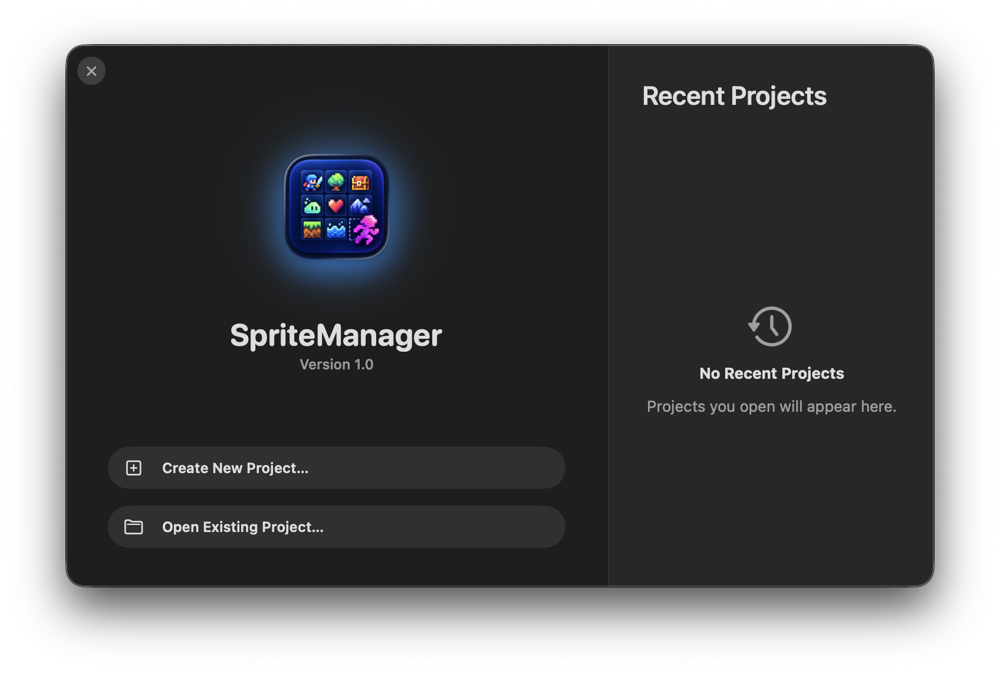

# SpriteManager

SpriteManager is a native macOS 14+ SwiftUI/AppKit application for managing pixel-art sprite libraries, portable `.pixproj` projects, spritesheets, and project-local color palettes.

## Features

- Global sprite library with stable UUIDs, PNG preservation, metadata, search, and `Unassigned` classification.
- Pixel-perfect sprite editing with integer-only shifting, clipping, transparency fill, undo, and redo.
- Multiple spritesheets per project with manual placement, duplication, integer coordinates, borders, and PNG/JSON export.
- Non-destructive project color palettes. Palette edits, aliases, previews, click-to-select, synchronized zoom/panning, and export rendering never modify source PNGs.
- Xcode-style Welcome window with native recent projects, Create/Open actions, `Window > Welcome to SpriteManager`, and `⇧⌘1`.
- Explicit saving through `Save Changes`, `File > Save`, or `⌘S`.

## Welcome screen



The Welcome screen provides quick access to recent projects and the actions to create or open a `.pixproj` project.

## Project structure

The source is intentionally split so each model, view, view model, store, document type, and utility has a focused file. Views compose controls and bindings; state transitions, filtering, rendering actions, import/export, and document coordination live in `*ViewModel` or model/store types.

The project uses Swift 6 language mode and Swift Testing. The native Xcode target includes every source file explicitly, including `Resources/AppIcon.icns`.

## Build and run

Open the native project and run the `SpriteManager` scheme with `⌘R`:

```sh
xed SpriteManager.xcodeproj
```

Or build and launch a standalone app bundle from the command line:

```sh
zsh scripts/run-app.sh
```

The command-line bundle is written to `.build/SpriteManager.app`. The native Xcode build produces the normal `.app` under DerivedData.

## Releases

The current application version is `0.1.0`. Releases use semantic versioning:

- `patch` increments the final number for small fixes and maintenance changes.
- `minor` increments the middle number for backward-compatible features.
- `major` increments the first number only when explicitly requested.

From a clean `main` worktree configured with the `Maetschl` Git identity, run one of:

```sh
./scripts/release.sh patch
./scripts/release.sh minor
./scripts/release.sh major
```

The script updates `Resources/Info.plist`, creates the commit and annotated tag, and pushes them to GitHub. The release workflow then runs the tests, builds a universal macOS application, creates a DMG, generates a SHA-256 checksum, and publishes a stable release at [GitHub Releases](https://github.com/Maetschl/SpriteManager/releases).

The initial DMG is not signed or notarized, so macOS may display a security warning when it is opened. The workflow has optional signing and notarization steps that can be enabled later with Apple Developer credentials stored as GitHub Actions secrets; a free Apple developer account does not provide the Developer ID certificate or notarization service required for this step.

To enable that path later, set the repository variable `SPRITEMANAGER_NOTARIZATION_ENABLED` to `true` and configure the secrets `APPLE_DEVELOPER_ID_CERTIFICATE_BASE64`, `APPLE_DEVELOPER_ID_CERTIFICATE_PASSWORD`, `APPLE_KEYCHAIN_PASSWORD`, `APPLE_ID`, `APPLE_TEAM_ID`, and `APPLE_APP_SPECIFIC_PASSWORD`.

## Verify

```sh
swift build
swift test
zsh scripts/test-release.sh
xcodebuild -project SpriteManager.xcodeproj -scheme SpriteManager -configuration Debug -sdk macosx CODE_SIGNING_ALLOWED=NO build
```

The test suite covers persistence, migration, library sharing, pixel operations, palette remapping and aliases, export manifests, Welcome layout metrics, and document behavior.

## Storage formats

The global library is stored at `Application Support/SpriteManager/Library`. A `.pixproj` document is a portable package containing `project.json` and embedded PNG assets. Existing `.spritesproject` documents remain readable. Spritesheet export writes the final PNG and a JSON manifest containing placement, palette, border, and renderer metadata.

